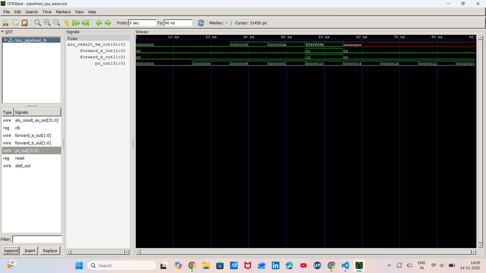

 5-Stage Pipelined RISC-V (RV32I) Processor in Verilog:

A modular, synthesizable 32-bit RISC-V (RV32I) processor supporting both **Single-Cycle** and **5-Stage Pipelined** (`IF, ID, EX, MEM, WB`) execution architectures, written from scratch in Verilog HDL.

 Key Features:
* **Complete RV32I Datapath & Control:** Supports Arithmetic (`ADD`, `SUB`, `AND`, `OR`, `ADDI`), Memory (`LW`, `SW`), and Branch (`BEQ`) instructions.
* **5-Stage Pipeline Architecture:** Implemented inter-stage pipeline registers (`IF/ID`, `ID/EX`, `EX/MEM`, `MEM/WB`) to maximize instruction throughput.
* **Data Hazard Resolution:** Dedicated **Forwarding Unit** (`EX/MEM` and `MEM/WB` bypass paths) to resolve Read-After-Write (RAW) hazards without stalling.
* **Load-Use Stall Handling:** **Hazard Detection Unit** that inserts pipeline bubbles (`NOP`) and freezes `PC` & `IF/ID` registers during load-use dependencies.

Repository Structure:
* `alu.v` — 32-bit Arithmetic Logic Unit
* `reg_file.v` — 32x32-bit Register File (with hardwired zero `x0`)
* `pc.v` — Program Counter
* `imem.v` & `dmem.v` — Instruction ROM & Data RAM modules
* `imm_gen.v` — Sign-extending Immediate Generator (I, S, B types)
* `control_unit.v` — Main Instruction Decoder & Control Signal Generator
* `hazard_units.v` — Data Forwarding Unit & Load-Use Hazard Detection Unit
* `riscv_single.v` — Top-level Single-Cycle RISC-V Processor
* `riscv_pipelined.v` — Top-level 5-Stage Pipelined RISC-V Processor

 Simulation & Waveform Verification:
Simulated using **Icarus Verilog (`iverilog`)** and verified via **GTKWave**. The waveform below demonstrates active data forwarding (`forward_a_out = 01`, `forward_b_out = 10`) during back-to-back dependent instructions:

